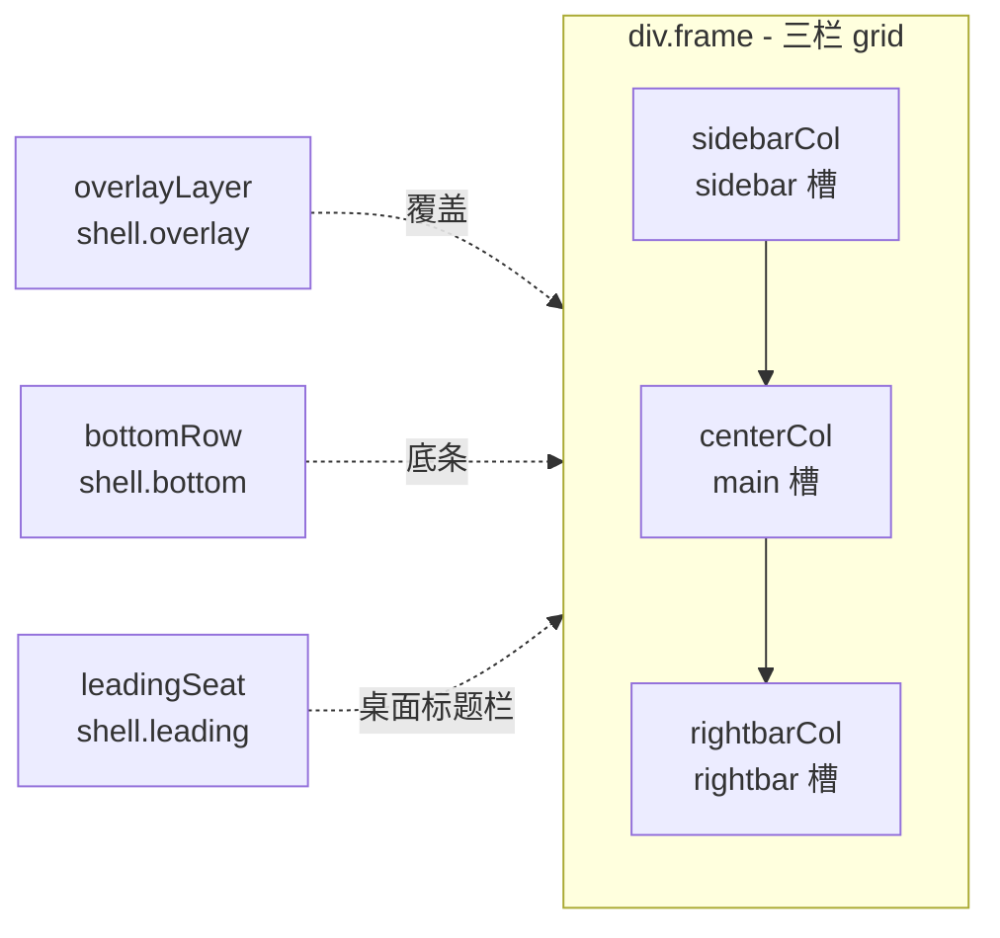
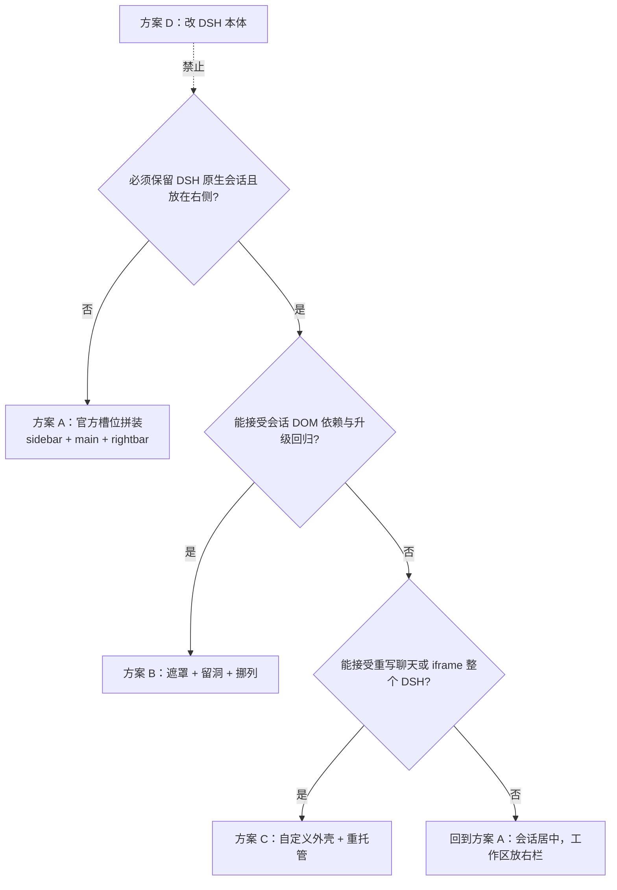
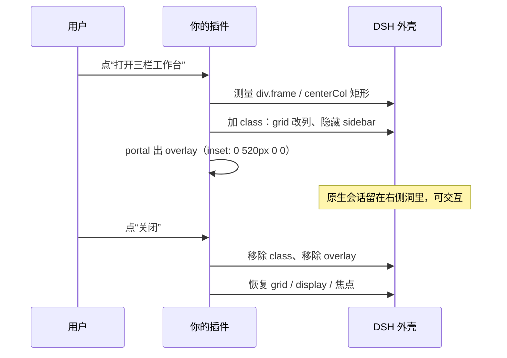

<!-- doc
id: dsh-shell-case
reader: 要改造 DSH 外壳的人
fact-source: DSH 客户端包（source map）、dsh-ui-extension skill 的生成表
checked: 0.15.5
rot-if: DSH 版本变化（槽表以 skill 生成表为准）
-->

# DSH 三栏外壳 · 改造案例（详细版）

> **这是三栏形态的详细案例，不是通用 skill。** 通用能力在独立仓库 [dsh-harness-remix](https://github.com/NewbieCheng/dsh-harness-remix)：
> [dsh-ui-remix](https://github.com/NewbieCheng/dsh-harness-remix/tree/main/skills/dsh-ui-remix)（UI 改造）、[dsh-backend-bridge](https://github.com/NewbieCheng/dsh-harness-remix/tree/main/skills/dsh-backend-bridge)（后端衔接）。
> 本文保留完整的插槽表、A/B/C 配方与逐条验收，供“会话放右边”这类具体形态参考。
> 基准：DSH Web 客户端（`@deepseek-ai/dsh-client-*`）+ 本仓 `dsh-openfilm` 0.13.4。
> 事实来源：DSH 客户端 source map + 真机界面。插槽数量与清单**不在本文维护**，见 §3。

---

## 0. 给 AI 的执行说明（先读这一节）

**你的角色**：DSH 外壳改造工程师。你要产出的不是“建议”，而是**能落地的改造**：插槽注册代码 / 注入脚本 / 样式 / 验收记录。

**硬约束（违反即回退）**：
1. 不改 DSH 本体（`app.asar`、`vendor/dsh`、DSH 源码）。
2. 不手改构建产物（`client.js` 之类），只改源码再构建。
3. 不在注入层承载权限、凭据、业务写操作。
4. 未在真机看到行为，不得写“已完成”。
5. 任何“遮罩/留洞”方案必须带**默认关闭的开关**，DSH 升级后先回归再开。

**执行顺序**：
1. 读 §2（认知模型）与 §3（插槽表），确认目标能用哪些槽；
2. 按 §4 的决策树选方案（A/B/C/D）；
3. 按对应配方施工（§5/§6）；
4. 用 §8 定位元素、§9 的注入范式写代码；
5. 用 §11 验收，记录 DSH 版本与证据。

**用户给的信息不足时**：先问 §12 的 3 个必答问题，不要猜。

---

## 1. 目标形态与验收标准

### 1.1 目标线框

```
┌──────────────────┬───────────────────────────────┬─────────────────────┐
│  左：插件导航     │  中：插件工作区                │  右：DSH 原生会话    │
│  （插件列表/项目） │  （编辑器、列表、详情…）        │  （消息流 + 输入框）  │
│                  │                               │                     │
│  [插件 A]        │  ┌─────────────────────────┐  │  ┌───────────────┐  │
│ ▶[插件 B]        │  │                         │  │  │ 用户/助手消息  │  │
│  [插件 C]        │  │      你的面板内容         │  │  │ 工具/思考卡片  │  │
│                  │  │                         │  │  └───────────────┘  │
│  项目列表         │  └─────────────────────────┘  │  [输入框] [发送]   │
└──────────────────┴───────────────────────────────┴─────────────────────┘
```

### 1.2 验收标准（缺一不可）

- [ ] 左栏可切换插件；选中态清晰；
- [ ] 中栏工作区可打开/关闭，缩放不错位；
- [ ] 右栏会话**可滚动、可输入、可发消息**，模型菜单/思考/工具卡片正常；
- [ ] 窗口缩放、侧栏折叠、右栏拖宽都不破；
- [ ] 暗/亮主题、窄屏不破；
- [ ] 关闭开关后**完全恢复**原生 UI；
- [ ] DSH 升级后按 §11 回归通过。

---

## 2. 30 秒认知模型

### 2.1 DSH 外壳是现成的三栏



- grid 由内联样式给出：`gridTemplateColumns: ${sidebar}px minmax(0/400px,1fr) minmax(0,rightbarMax)`。
- `main` 的渲染：`renderSlot("main", {}, { entryKey: panelId ?? "conversation" })`。
- **会话就是 `main` 的一个 entry（key = `conversation`）**；有全局面板激活时，会话被替换。
- `rightbar` 是独立轨道，给文件/终端/文档面板用，**不是会话容器**。

### 2.2 三个必须记住的结论

| # | 结论 | 后果 |
|---|---|---|
| 1 | 会话是 `main` 的 entry，不是可搬组件 | 不能把会话“放进”自己的容器 |
| 2 | `main` 同一时刻只显示一个 entry | 会话与工作区**互斥**（除非改布局） |
| 3 | DSH 没导出聊天组件 | 不能 `require` 一个 `<Chat/>` 放进右栏 |

> 推论：**会话只能“露出来”，不能“搬进去”。** 目标形态要么接受会话居中（A），要么给原生会话留洞（B）。

---

## 3. 插槽从哪查（不要在这里维护表）

**槽表不写在这篇文档里。** 手抄的表在 0.15.1 已经过期（当时写着 77 个，真机是 116 个，而且 0.2.2 起多了 `hoc` 基数）。

- 完整清单与基数/作用域/替换风险：装 `dsh-ui-extension` skill，读它的 `reference/slots.generated.md`（由 live inspect 生成）；
- 实时查询：`cordis_inspect_query { platform:"client", provider:"Slots", method:"listSubTree" }`；
- 本仓"用了哪个槽"见 [`reference/ui-layers.md`](reference/ui-layers.md) 与 [`reference/injection-registry.md`](reference/injection-registry.md)。

## 4. 选型：四种改造方案

### 4.1 决策树



### 4.2 对比矩阵

| 维度 | A 原生槽位 | B 遮罩+留洞 | C 自定义外壳 | D 改本体 |
|---|---|---|---|---|
| 会话在右 | ❌（居中） | ✅（原生） | ⚠️（重写/iframe） | ✅ |
| 原生会话可交互 | ✅ | ✅ | ⚠️ | ✅ |
| 升级稳定 | ✅ | ⚠️（DOM 依赖） | ⚠️ | ❌ |
| 工作量 | 低 | 中 | 高 | 低但危险 |
| 可回滚 | ✅ | ✅（开关） | ✅ | ❌ |
| 推荐度 | ★★★★ | ★★★ | ★ | 禁止 |

**默认建议**：先 A 打底，再按需加 B（B 只作为可选皮肤，默认关）。

---

## 5. 方案 A 配方（官方槽，稳定优先）

### 5.1 左：插件导航

```js
ctx.slots.inject('sidebar.panellist', () => ctx.slots.register({
  name: 'sidebar.panellist',
  id: 'my-workbench',      // 同时作为 main 面板的 key
  order: 21,
  locale: NS,
  label: () => '我的工作台',
}, PanelIcon));
```

- 只放图标 + 短名；长名放 tooltip。
- 需要“底部大入口”时可改用 `sidebar.footer.action`。

### 5.2 中：全局面板

```js
ctx.slots.inject('main', () => ctx.slots.register({
  name: 'main',
  key: 'my-workbench',     // 必须与 panellist 的 id 一致
  order: 10,
  locale: NS,
}, PanelSeat));
```

- `PanelSeat` 只做占位；重 UI 放 `shell.overlay`（常驻，不随切页重载），用 `getBoundingClientRect` 跟随占位矩形。
- 面板打开时会话被替换——给用户明显的“返回会话”入口。

### 5.3 右：rightbar 面板

- 往 `rightbar` 注册 entry；按 `{width, viewportWidth, canShow}` 决定显隐与宽度；
- 右栏是轨道，面板贴右边缘，可拖宽；
- `rightbar` 的 entry 契约以真机为准，接之前先加验收项。

### 5.4 打开/关闭与引导

- 首次安装：`localStorage` 记 `onboarded`，第一次打开显示 2–3 步引导，不自动弹全屏；
- 空状态：无项目时显示“先在 X 里打开一个项目”；
- 开关：`localStorage` 或环境变量，默认开（A 方案稳定，无需默认关）。

---

## 6. 方案 B 配方（遮罩 + 留洞 + 挪列）

> 目标：左+中自定义，右侧留出原生会话。**这是唯一保留原生会话并放在右侧的现实路径。**

### 6.1 时序



### 6.2 为什么最后没走这条路

当时的做法是：用一个固定定位的遮罩盖住左+中列，再用 `!important` 把 `div.frame` 的 grid
改成 `0 / 1fr / 520px`，把会话列挪到右边，然后用 `ResizeObserver` + `MutationObserver`
跟住 DSH 自己重写内联样式。

撤回的原因不在实现难度，而在**边界**：DSH 每次重写 `frame` 的内联 grid 都要重贴一次，
侧栏折叠、主题切换、语言切换、窄屏抽屉、弹窗层级全都各要一条特判；只支持 ≥1100px，
而"被盖区域不能 Tab 进去"这件事没有稳定做法。任何一条漏掉，表现就是"面板错位/焦点跑掉"，
用户以为坏了。

结论：这条只适合一次性演示，不适合长期维护。现行做法见 §5（官方槽 + `shell.overlay`）。

## 7. 方案 C / D

### C：自定义外壳 + 重托管会话

- 整屏 portal，自绘三栏；
- 会话只能二选一：iframe 整个 DSH（会带出全部 UI）或自己重写聊天（接会话/流服务，重做审批、模型菜单、思考流、工具卡片）；
- 适用：完全自研聊天体验；**不推荐**，除非明确不要原生会话。

### D：改 DSH 本体

- 改 `AppFrame`/conversation 插件/`app.asar`：升级即坏，违反红线。**禁止。**

---

## 8. 元素定位图

### 8.1 侧栏“工作区”标题行（源码结构，非类名）

```
div.sectionHeader
├─ span.sectionLabel        ← 文本“工作区”；groupBy=flat 时是“会话”
├─ div.searchSlot
│   └─ div.search → button.searchButton + input.searchInput
├─ div.headerActions        ← ViewSettingsMenu（筛选）+ button.iconButton（新建工作区）
└─ div.listArea             ← 列表：SearchResults / FlatList / SessionTree
```

**找法**：`span.textContent.trim()` ∈ {工作区, 会话}，父节点含 `input` 且 `button` ≥ 2。
**别动**：搜索、筛选、新建。
**列表**：header 的下一个兄弟（`listArea`）。

### 8.2 其他位置

| 元素 | 位置 |
|---|---|
| 插件入口 | `sidebar.panellist`（注册，不要 DOM 找） |
| 侧栏底部入口 | `sidebar.footer.action` |
| 面板常驻层 | `shell.overlay` |
| 设置弹窗 | 原生；`settings.section` / `settings.general.item` 可插 |
| 外壳 grid | `div.frame` 内联 `gridTemplateColumns`；`data-shell-overlay` 等属性 |

> 类名是 CSS Module 哈希（如 `_sectionHeader_xxx`），**不要写死**；用文本+结构锚点。

---

## 9. 注入范式（B2，最后手段）

```js
const MARK = 'data-my-inject';

function install(doc) {
  let mounted = null;
  let observer = null;

  const cleanup = () => {
    for (const n of doc.querySelectorAll(`[${MARK}]`)) n.remove();
    if (mounted?.hidden) mounted.hidden.style.display = '';
    mounted = null;
  };

  const mount = () => {
    const found = findAnchor(doc);           // 文本+结构，不用哈希类名
    if (!found) { cleanup(); return; }
    if (mounted?.el === found.el && mounted.el.isConnected) return;
    cleanup();                               // 每轮先清，防重复
    // 插节点、挂事件、记 mounted
  };

  let scheduled = false;
  const schedule = () => {
    if (scheduled) return;
    scheduled = true;
    const run = () => { scheduled = false; mount(); };
    (doc.defaultView?.requestAnimationFrame ?? setTimeout)(run);
  };

  observer = new MutationObserver(schedule);
  observer.observe(doc.body, { childList: true, subtree: true });
  mount();

  return () => { observer?.disconnect(); cleanup(); };  // 必须返回 disposer
}
```

**要点**：
- 只追加、不替换；被隐藏的原节点要能恢复；
- 每轮 `cleanup`，避免 React 重渲染后出现“双份”；
- 所有注入节点带 `data-*` 标记；
- 弹出层挂 `document.body`，`z-index` 低于 DSH 弹窗；
- 返回 disposer，插件卸载/热重载不残留。

---

## 10. 引导（onboarding）配方

1. **触发**：首次打开该工作台时（`localStorage['<ns>.onboarded']` 为空）。
2. **形式**：3 步以内的轻量提示（不是全屏弹窗）：① 左栏选插件 ② 中栏是工作区 ③ 右栏是会话。
3. **可跳过**：右上角“跳过”，记 `onboarded=1`。
4. **空状态**：没有项目时给“新建/打开项目”的入口，不要空白。
5. **不自动弹全屏**：首次打开由用户点击入口触发。

---

## 11. 测试与回归

**代码**
- [ ] 构建通过（不改产物）；
- [ ] 注入/清理幂等（重复挂载只有一个）；
- [ ] disposer 移除 observer/节点；
- [ ] 开关关闭后 DOM 完全恢复。

**真机**
- [ ] 左栏入口显示/点击/切回；
- [ ] 中栏工作区打开/缩放；
- [ ] 右栏会话可滚动/输入/发消息；模型/思考/权限可用；
- [ ] 窗口缩放、侧栏折叠、右栏拖宽；
- [ ] 暗/亮主题、窄屏；
- [ ] DSH 升级后回归（记录版本）；
- [ ] 关闭开关完全恢复。

**证据**
- 截图/录屏、`npm test` 输出、DSH 版本号；未真机验证不写“完成”。

---

## 12. 必答问题（信息不足先问）

1. “右侧会话”是 **DSH 原生会话**，还是插件面板里的聊天？
2. 三栏顺序确认：**左插件导航｜中工作区｜右 DSH 会话**？
3. 能否接受 **A**（会话居中、工作区在右栏）？必须“会话在右”才走 **B**。
4. 中栏是现有插件面板还是新写的？
5. 左栏用 `sidebar.panellist` 还是自绘？
6. 替换现有入口还是新增并存？
7. 引导要求（步骤/可跳过/记忆）？
8. 目标 DSH 版本；接受“升级后 B 先关”吗？

---

## 13. 附录

### 13.1 插槽/源码提取法

```sh
dsh web --port 47824 --no-open          # 输出带 token 的 URL
# 1) 取首页 HTML（curl -c/-b cookie），抓 plugins/??<pkg>/client.js&rev=<rev>
# 2) 换成 client.js.map&rev=... 取 source map
# 3) 解析 sections[].map.sourcesContent 拼源码
# 4) grep slots.inject / slots.register / renderSlot
```

### 13.2 术语表

| 词 | 含义 |
|---|---|
| 外壳 shell | DSH Web 整体框架（侧栏/主区/右栏/遮罩层） |
| 槽 slot | 外壳暴露的挂载点 |
| entry | 槽里注册的一项；`main` 的 entry 有 `key` |
| 面板 panel | 占 `main` 或 `rightbar` 的整块 UI；会话也是 `main` 面板 |
| overlay | 盖在外壳之上的层（`shell.overlay` 或 portal） |
| B2 | 不改源码的 DOM/行为注入 |

### 13.4 作为 skill 使用

通用版在独立仓库 **[dsh-harness-remix](https://github.com/NewbieCheng/dsh-harness-remix)**，与本仓无关，装到 DSH 即可：

| skill | 覆盖 |
|---|---|
| `dsh-ui-remix` | 通用 UI 改造：替换原生组件、任意插槽、整壳接入（iframe/WebView）、留洞、主题、元素定位、注入范式 |
| `dsh-backend-bridge` | 后端衔接：Host 骨架、路由/鉴权、ACP 边车、模型/权限、存储、诊断、测试 |

```sh
git clone https://github.com/NewbieCheng/dsh-harness-remix.git
cp -r dsh-harness-remix/skills/* ~/.dsh/skills/
```

装好后对 AI 说“用 dsh-ui-remix 改造界面”或“用 dsh-backend-bridge 接后端”即可。
本文档继续作为三栏形态的**详细案例**，两者互补。

