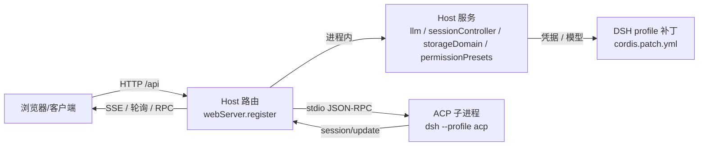

# DSH 后端衔接（Host / 路由 / ACP / 模型 / 权限）

> 配套：`reference/host-api.md`（服务与路由模板）、`reference/acp.md`（对话边车全流程）、
> `reference/models-permissions.md`（模型目录与权限）、`reference/diagnostics.md`（日志/验收/测试）。
> 事实来自本仓 `dsh-openfilm` 的真机实现；版本：DSH 桌面版 2026-11。

---

## 0. 先分清三条链路



| 链路 | 你要做的事 | 不该做的事 |
|---|---|---|
| Host 路由 | 鉴权、参数校验、调服务/子进程、返回 JSON/流 | 把任何 URL 当编辑器来源、把路由当沙箱 |
| Host 服务 | 用 `ctx.llm` / `ctx.sessionController` / `ctx.storageDomain` | 在顶层做 IO、自己存凭据明文 |
| ACP 子进程 | 用 `dsh --profile acp` 起独立会话 | 在浏览器侧拼 ACP 消息 |

---

## 1. Host 插件骨架

```js
export const inject = ['tools', 'connection', 'webServer', 'llm', 'agentDefaultModel',
  'storageDomain', 'sessionController', 'systemPrompt', 'agents'];

export function apply(ctx) {
  ctx.effect(() => ctx.tools.register(myTool()), 'my-plugin: tool');
  ctx.effect(() => createMyController(ctx, deps), 'my-plugin: controller');
}
```

- **`ctx.effect(setup, label)`**：返回 disposer；Host 重载/禁用时自动清理，路由、定时器、子进程都放里面。
- **依赖用 `createX(deps)`**，不在模块顶层做 IO/读文件；便于测试注入 mock。
- 需要权限预设时：`ctx.get('permissionPresets')`（可能不存在，要判空）。

---

## 2. Web 路由与鉴权（最小模板）

```js
const route = {
  kind: 'exact',
  path: '/api/my-plugin/status',
  async handler(req, res) {
    res.setHeader('cache-control', 'no-store');
    if (req.method !== 'GET') { res.writeHead(405, { allow: 'GET' }).end(); return; }
    // DSH 的 Host/Origin 与“已认证浏览器 peer”双重校验
    const admission = ctx.connection.admit({ headers: req.headers });
    if ('rejection' in admission) {
      res.writeHead(admission.rejection).end(admission.rejection === 403 ? 'ORIGIN_REJECTED' : 'SESSION_REQUIRED');
      return;
    }
    if (admission.peer.id !== ctx.connection.browserPeer.id) { res.writeHead(403).end('BROWSER_REQUIRED'); return; }
    res.writeHead(200, { 'content-type': 'application/json' }).end(JSON.stringify({ ok: true }));
  },
};
const dispose = ctx.webServer.register(route);
ctx.effect(() => dispose, 'my-plugin: route');
```

要点：
- `register()` 只接受**一个**路由；多个路由要多次注册；
- 路径唯一，重复注册会抛错；注册失败要能回滚已注册的；
- 浏览器请求带 DSH 的会话 cookie；跨站/无 Origin 的请求会被 `admit` 拒；
- 桌面 `dsh-app://` 下相对 `/api` 会 404，需要 Host 的绝对地址或一次性 bootstrap ticket。

---

## 3. ACP 对话边车（推荐接法）

**为什么用 ACP**：把对话交给 `dsh --profile acp` 子进程，模型、思考、权限、工具、会话持久化都是 DSH 的，不用自己实现。

```js
import { createAcpClient } from './acp-client.mjs';

const client = createAcpClient({ args: ['--profile', 'acp'] });
await client.start();
const { sessionId, configOptions } = await client.newSession({ cwd: projectDir });
await client.prompt({ sessionId, blocks: [{ type: 'text', text: '你好' }] });
// 事件：session/update → agent_message_chunk / agent_thought_chunk / tool_call / ...
```

**配置选项**（`session/new` 返回）：
- `model`：分组（provider → models），值形如 `["opencode-go","deepseek-v4.1-flash"]`；
- `reasoning_effort`：`off/low/high/max`（第三方可能没有 `off`）；
- **没有 permission 选项**：权限是会话级预设，用环境变量 `DSH_PERMISSION_MODE` 传给子进程。

**模型同步**：`acp` profile 默认没有你桌面 profile 的渠道。启动时把桌面 profile 的 `llm-pi-ai` 渠道**幂等**写进 `~/.dsh/profiles/acp/cordis.patch.yml`（只抄渠道名/地址/模型/`apiKeyEnv`，密钥仍在 DSH 凭据里）。参考 `src/acp-profile-models.mjs`。

**会话映射**：项目 → ACP sessionId 存 `~/.dsh/no996-openfilm/acp-sessions.json`；DSH 会话本体在 `~/.dsh/sessions/<编码 cwd>/<id>/session.v4.jsonl.zstd`，不要手改。

---

## 4. 模型与权限

| 主题 | 做法 |
|---|---|
| 列模型 | `ctx.llm.listProviders()` / `listModels()`；ACP 用 `configOptions.model` |
| 默认模型 | `ctx.agentDefaultModel.currentSelection()` → 用 `session/set_config_option` 应用 |
| 渠道配置 | profile 的 `cordis.patch.yml`：`llm-pi-ai` 的 `providers`（`id/baseURL/models/apiKeyEnv`） |
| 密钥 | 只存凭据/环境变量名，不进日志、不进前端 |
| 权限 | `permissionPresets.set(session, name)`；默认 `danger-full-access`；ACP 用 `DSH_PERMISSION_MODE` |
| 权限与模型 | **权限是会话/项目级，不是模型级**；不要按模型禁用权限 UI |

---

## 5. 存储与诊断

| 数据 | 位置 |
|---|---|
| DSH 会话 | `~/.dsh/sessions/<encoded-cwd>/<session-id>/` |
| 插件存储域 | `ctx.storageDomain`（JSON 持久化） |
| 项目→会话映射 | `~/.dsh/no996-openfilm/acp-sessions.json` |
| 插件日志 | `%TEMP%\dsh-openfilm\plugin.log`（JSON Lines） |
| Host 标记 | `%TEMP%\dsh-openfilm-host.json`（version/pid/startedAt） |
| 诊断接口 | `POST /api/no996-openfilm/diagnose {projectId}` |

日志要**脱敏**；不要把密钥、完整 prompt、用户文件内容写进日志。

---

## 6. Profile 补丁与生效

```yaml
- insert:
    - id: my-plugin
      name: my-plugin
      config:
        port: 0
```

- `!!js` 可写条件表达式；
- 改 `cordis.patch.yml` 后：重新 `install_bundle` 或重启 Host；已有会话不迁移；
- 改 Host 源码：**先 `touch index.js src/*.mjs`**，再重载插件，否则旧 import 还在；
- 改客户端源码：`npm run build` 后刷新；
- 插件不是热加载；管理器返回 `restart-required` 时如实报告。

---

## 7. 测试规范（必须遵守）

- `node --test --experimental-test-isolation=none tests/*.test.mjs`；
- **禁止真实模型调用**：用 mock / 假 ACP 子进程 / `mkdtemp` 临时目录；
- `OPENFILM_HOME`/`OPENFILM_LIBRARY_CACHE` 指临时目录，别写用户真实目录；
- 断言形状：ACP 字段以真实子进程探测或假 agent 为准，不靠猜；
- 新增行为必须带测试；本仓历史 bug 多是“逻辑对但顺序/形状假设错”。

---

## 8. 真机验收（ACP 衔接）

- [ ] 模型菜单出现你的渠道（`opencode-go` 等），默认模型跟随 DSH 当前选择；
- [ ] 思考流：`agent_thought_chunk` 一段段出现，不是“一下全出来”；
- [ ] 权限：项目预设可改；面板默认完全访问；子进程按 `DSH_PERMISSION_MODE` 生效；
- [ ] 续聊：重启 Host 后同一项目能 resume 到原会话；
- [ ] 失败可诊断：日志有 `acp-model-fallback` / `acp-default-model-failed` 之类的明确事件；
- [ ] 未验证不写完成。

---

## 9. 常见坑

| 坑 | 原因 | 解 |
|---|---|---|
| 面板里模型退回 `deepseek-v4-flash` | acp profile 没有你的渠道 | 启动时同步 provider（§3） |
| 权限行消失/选不了 | DSH 主聊天按预设/模型控制 UI | 面板权限走项目预设；主聊天是 DSH 本体，改不了 |
| 子进程起不来 | 找不到 `dsh`/profile | `resolveAcpCommand` 兜底；显式 `args` |
| 路由 404/403 | 路径重复/未认证/跨源 | 检查 `register` 唯一性、`admit`、Origin |
| 改了没生效 | 客户端没 build / Host 没重载 / 没 touch | 按生效矩阵 |
| 会话“丢”了 | 看错目录或 cwd 变了 | 查 `acp-sessions.json` 与 sessions 目录 |
| 测试打真模型 | 没 mock | 用假 ACP agent + 临时目录 |

---

## 10. 配套文件

| 文件 | 内容 |
|---|---|
| `reference/host-api.md` | 服务清单、路由/鉴权模板、effect/dispose、存储 |
| `reference/acp.md` | ACP 全流程：spawn、session、config options、事件、权限、resume、provider 同步 |
| `reference/models-permissions.md` | 模型目录映射、默认选择、权限预设与环境变量 |
| `reference/diagnostics.md` | 日志、标记、诊断接口、测试命令、验收 |
