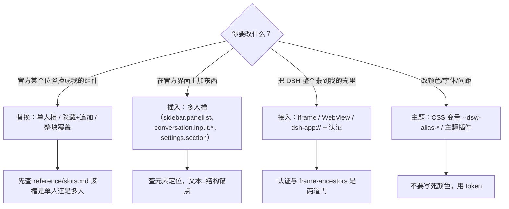
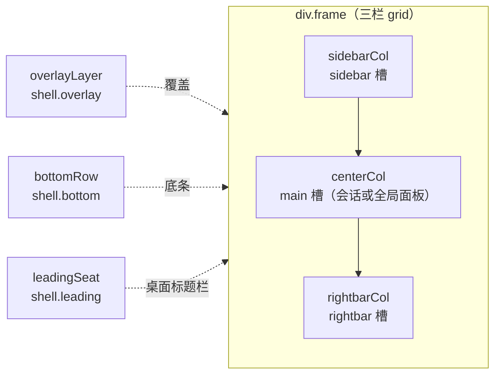

# DSH UI 改造（通用）

> 这是一份**通用**的 DSH 界面改造指南，不绑定某个具体插件。
> 三种诉求都能在这里找到做法：**① 替换官方位置上的原生组件；② 在官方界面上加/改区块；③ 把 DSH 官方 UI 整个接到另一个地方。**
> 事实来源：DSH Web 客户端 source map（77 个插槽）+ 真机。基准 2026-11，DSH 桌面版。
> 配套：`reference/slots.md`（插槽全表）、`reference/element-map.md`（元素定位）、`reference/recipes.md`（可直接抄的配方）。

---

## 0. 先判断：你要的是哪一种改造？



### 三条铁律

1. **不改 DSH 本体**（`app.asar`、DSH 源码、`vendor/dsh`）；只通过插槽、样式、注入、配置。
2. **不手改构建产物**；只改源码再构建。
3. **未真机验证不写“完成”**；任何覆盖/遮罩方案必须带可关闭开关。

---

## 1. 认知模型：DSH 外壳长什么样



| 事实 | 说明 |
|---|---|
| 外壳是三栏 | `gridTemplateColumns: sidebar px · minmax(0/400,1fr) · rightbar` |
| 主区单选 | `main` 用 `entryKey` 选一个：`conversation` 或某个全局面板 |
| 会话不可搬 | 会话是 `main` 的 entry，DSH 没导出聊天组件；`rightbar` 只给文件/终端/文档面板 |
| overlay 不是 body 级 | `shell.overlay` 在 frame 内；`createPortal(..., document.body)` 才是“盖住一切” |
| 数据属性 | `data-sidebar-collapsed`、`data-rightbar-col`、`data-shell-overlay`、`data-shell-bottom`、`data-shell-leading`、`data-global-panel` |

**结论**：想“保留原生会话在右侧”，只能“露出来”（留洞），不能“搬进去”。

---

## 2. 替换官方原生组件：四种情况

> 先打开 `reference/slots.md` 查这个槽是**单人**（single）还是**多人**（multi）。

### 2.1 单人槽：注册即替换

| 槽 | 原来是什么 | 替换代价 |
|---|---|---|
| `sidebar.workspaces` | 整块工作区（标题+搜索+筛选+新建+列表） | 要自己复刻搜索/筛选/新建/分组，最容易做残 |
| `sidebar.brand.mark` / `sidebar.brand.name` | 品牌图标/名字 | 低，只换视觉 |
| `shell.leading` | 桌面标题栏左侧（红绿灯旁） | 低，注意 `-webkit-app-region: drag` |
| `sidebar.settings` | 设置入口 | 低 |

做法：

```js
ctx.slots.inject('sidebar.brand.mark', () => ctx.slots.register({
  name: 'sidebar.brand.mark', id: 'my-brand', order: 1,
}, MyMark));
```

**注意**：单人槽注册后，原来那一份就不渲染了；先确认你能接受缺失的功能，否则改用 §2.3。

### 2.2 多人槽：只能“加”，不能“换”

绝大多数槽是追加式（`sidebar.panellist`、`sidebar.footer.action`、`conversation.input.right`、`settings.section`…）。要“换掉”某个官方元素，用 **隐藏 + 追加**：

```js
// 1) 找到官方元素（文本+结构锚点，见 reference/element-map.md）
const official = findOfficialLabel();
official.style.display = 'none';      // 只隐藏，不删除
// 2) 在它旁边插入你的
official.parentElement.insertBefore(myButton, official);
// 3) 返回 disposer，恢复 display
```

**必须**：可恢复、幂等、React 重渲染后重贴（MutationObserver + cleanup）。

### 2.3 插入式改造（最稳）

在官方位置**加**你的区块，不动官方逻辑：

| 想加什么 | 用哪个槽 |
|---|---|
| 侧栏插件入口 | `sidebar.panellist` |
| 侧栏底部入口 | `sidebar.footer.action` |
| 输入框右侧按钮 | `conversation.input.right` |
| 输入框左侧按钮 | `conversation.input.left` |
| 会话头部按钮 | `conversation.session.header.actions` |
| 设置页一节 | `settings.section` / `settings.general.item` |
| 消息卡片 | `conversation.chat.node` |
| 空会话首屏 | `conversation.hero.options` |

### 2.4 整块替换/覆盖：全屏或留洞

- `shell.overlay`：在外壳层内加覆盖层（低于弹窗层，推荐）；
- `createPortal(..., document.body)`：真正全屏（`z-index` 低于 DSH 弹窗 ~1200）；
- **留洞**：`position: fixed; inset: 0 520px 0 0;` 把右侧留给原生会话（详见 `reference/recipes.md` 配方 5）；
- 全屏覆盖必须带开关，DSH 升级后先回归。

---

## 3. 把 DSH 官方 UI 接到另一个地方（re-host）

> 场景：你有一个自己的壳（Electron/WebView/网页），想把 DSH 的整套界面嵌进去；或者反过来，把 DSH 的面板嵌进你的页面。

### 3.1 三种接入方式

| 方式 | 做法 | 代价/限制 |
|---|---|---|
| A. iframe 整个 DSH Web | `<iframe src="http://127.0.0.1:<port>/?token=...">` | 会带出整套 UI；需要 token/cookie；`frame-ancestors` 要放行你的来源 |
| B. WebView 桌面壳 | Electron `BrowserWindow`/`webview` 指向 `http://127.0.0.1:<port>` 或 `dsh-app://app` | 桌面端走 `dsh-app://` 时相对 `/api` 会 404，需要 Host 转发/一次性 ticket |
| C. 只接入某个面板 | 把插件面板做成独立页面/iframe，嵌进别的系统 | 不能只接“会话”（无导出组件）；会话只能整壳 iframe |

### 3.2 认证（第一道门）

- `dsh web` 打印的 URL 带 `?token=...`；用浏览器打开会种 cookie，之后的 `/api` 才 200。
- 从别的域/壳嵌入时：
  - iframe 的 `src` 必须带 token（或先在同源打开一次拿 cookie）；
  - 跨源 iframe 里 cookie 可能被 SameSite 拦；优先**同源**部署或反向代理到同一 origin；
  - `frame-ancestors` 必须包含你的来源，否则静默白屏（页面不报错，只是不显示）。

### 3.3 嵌入后的坑

| 坑 | 处理 |
|---|---|
| 相对 `/api/...` 404 | 桌面 `dsh-app://` 下没有 http origin；用 Host 的绝对地址或 bootstrap ticket |
| 双滚动条/键盘焦点 | iframe 内 `overflow` 与宿主分离；给 iframe `allow="clipboard-read; clipboard-write"` 按需 |
| 主题不一致 | 传 `?theme=dark` 或 postMessage；用 DSH 的 `--dsw-alias-*` token |
| 登录态 | 不要在 URL 里长期带 token；用一次性 ticket/短时 cookie |
| 缩放/DPI | iframe 内部按自己的 `devicePixelRatio`，宿主缩放会导致模糊；必要时调 `zoom` |
| 跨版本 | 记录 DSH 版本；升级后回归 |

### 3.4 “只把会话搬进我的壳”行不行？

**不行。** 会话没有独立可导出的组件；`main` 是单选区，`rightbar` 不是会话容器。可行替代：
- 整壳 iframe（会带全部 UI）；
- 留洞（把 DSH 壳放在底层，右侧露出会话，你的 UI 盖左+中）；
- 自己重写聊天（接会话/流服务，工作量大，不推荐）。

---

## 4. 元素定位法（不要写死哈希类名）

DSH 的类名是 CSS Module 哈希（如 `_sectionHeader_a1b2c`），**升级即变**。用**文本 + 结构**定位：

```js
function findHeader(doc) {
  for (const span of doc.querySelectorAll('span')) {
    if (span.textContent.trim() !== '工作区' && span.textContent.trim() !== '会话') continue;
    const header = span.parentElement;
    if (!header || !header.querySelector('input')) continue;          // 搜索框
    if (header.querySelectorAll('button').length < 2) continue;       // 筛选 + 新建
    return { span, header };
  }
  return null;
}
```

常用锚点见 `reference/element-map.md`：

| 元素 | 结构 |
|---|---|
| 工作区标题 | `div.sectionHeader > span.sectionLabel`（文本“工作区/会话”） |
| 搜索/筛选/新建 | `div.searchSlot`、`div.headerActions`（不要动） |
| 工作区列表 | header 的下一个兄弟 `div.listArea` |
| 侧栏插件入口 | `sidebar.panellist`（注册，不找 DOM） |
| 面板常驻层 | `shell.overlay` |
| 设置弹窗 | 原生；`settings.section` 可插 |

---

## 5. 注入范式（B2，最后手段）

```js
const MARK = 'data-my-inject';
function install(doc) {
  let observer = null, mounted = null;
  const cleanup = () => {
    for (const n of doc.querySelectorAll(`[${MARK}]`)) n.remove();
    if (mounted?.hidden) mounted.hidden.style.display = '';
    mounted = null;
  };
  const mount = () => {
    const found = findAnchor(doc);
    if (!found) { cleanup(); return; }
    if (mounted?.el === found.el && mounted.el.isConnected) return;
    cleanup();                       // 每轮先清，防 React 重渲染后双份
    // 插节点、挂事件、记 mounted
  };
  let scheduled = false;
  const schedule = () => { if (scheduled) return; scheduled = true;
    (doc.defaultView?.requestAnimationFrame ?? setTimeout)(() => { scheduled = false; mount(); }); };
  observer = new MutationObserver(schedule);
  observer.observe(doc.body, { childList: true, subtree: true });
  mount();
  return () => { observer?.disconnect(); cleanup(); };   // 必须返回 disposer
}
```

要点：只追加、被隐藏节点可恢复、所有注入节点带 `data-*`、弹出层挂 `document.body`、`z-index` 低于 DSH 弹窗、返回 disposer。

---

## 6. 主题与样式

- 统一用 DSH 的 CSS 变量：`--dsw-alias-bg-base`、`--dsw-alias-label-primary`、`--dsw-alias-border-l1`、`--dsw-alias-brand-primary` 等；
- 不要写死 `#fff/#000`；暗色/亮色由变量切换；
- 需要整套换肤时用主题插件/样式文件（本仓 `assets/theme/*.css`），不要逐个节点内联；
- 覆盖官方组件时，优先改**变量**，其次加类，最后才 `!important`；`!important` 只用于 DSH 内联样式（如 grid）。

---

## 7. 验收清单（真机，缺一不可）

- [ ] 目标位置显示正确；替换/新增后可恢复；
- [ ] 被隐藏的官方功能仍可通过你的入口触达（或明确告知用户已移除）；
- [ ] 缩放窗口、侧栏折叠、右栏拖宽、主题切换、窄屏不破；
- [ ] 会话（若保留）可滚动/输入/发消息，模型菜单/思考/权限/审批可用；
- [ ] iframe/WebView 接入：认证、frame-ancestors、双滚动条、焦点都验过；
- [ ] 开关关闭后完全恢复原生 UI；
- [ ] 记录 DSH 版本 + 截图/录屏证据。

---

## 8. 常见坑

| 坑 | 原因 | 解 |
|---|---|---|
| 元素定位给 `src/client-entry.js` 之类路径 | 它指到客户端入口，不是组件 | 用源码结构 + 文本锚点 |
| 注入后出现两份按钮 | React 重渲染换了节点 | 每轮 cleanup + MutationObserver |
| 面板打开后会话不见了 | `main` 单选，面板替换了会话 | 接受互斥，或做留洞方案 |
| 全屏 overlay 盖住 DSH 弹窗 | z-index 过高 | 低于 1200；弹窗层不要盖 |
| iframe 白屏 | `frame-ancestors` 没放行 | 配 Host 的 frame-ancestors / 同源 |
| iframe 里 `/api` 404 | `dsh-app://` 下无 http origin | 用 Host 绝对地址或 bootstrap ticket |
| 侧栏下拉重复 | 没清理旧节点 | `cleanup()` 先删再挂 |
| 改完没生效 | 客户端要 build；Host 要重载 | 按生效矩阵：build/重载/刷新 |

---

## 9. 配套文件

| 文件 | 内容 |
|---|---|
| `reference/slots.md` | 77 个插槽全表（单人/多人、用途、稳定性） |
| `reference/element-map.md` | 工作区标题、搜索/筛选/新建、列表、设置、侧栏、会话的定位 |
| `reference/recipes.md` | 换品牌、工作区下拉、全局面板、全屏留洞、iframe 接入、输入区按钮、设置页、主题 |

## 10. 开工前必问

1. 你要动的是**官方某个位置**，还是**整壳接入**？
2. 会话是 **DSH 原生会话**，还是插件面板里的聊天？
3. 替换后，官方原来的功能是**保留入口**还是**明确移除**？
4. 目标 DSH 版本？接受“升级后覆盖类方案先关掉”吗？
